# Device Art Card

**Animated, realistic device drawings for your Home Assistant dashboard.** **1,619 drawings** in **17 categories** and 115 groups:
lights, fans, appliances, locks, sensors, plants and more. Builder cards and plant/tree builders add thousands more combinations. Each one comes alive with your device's state: lamps glow in the bulb's color, fans spin with their speed, washers
show their cycle and doors open. **429 of them are multi-function:** each door, light, reading or stage can follow its own entity.

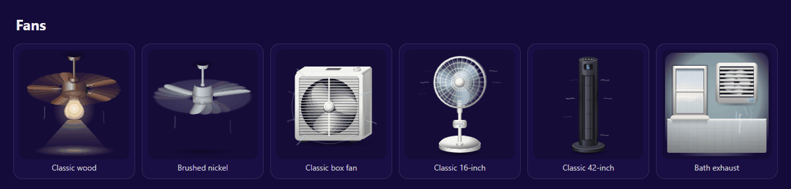
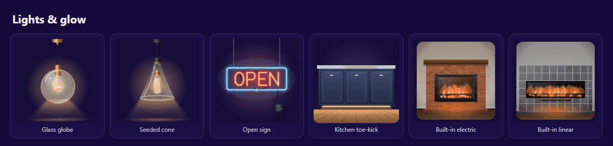
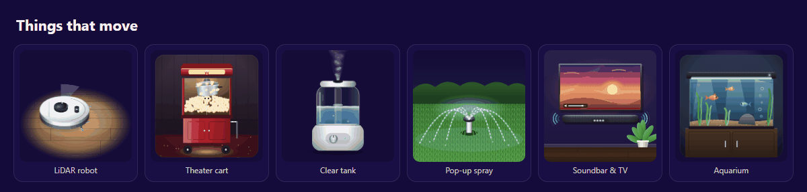

## What's new in 1.3.5: map icons for people on the move

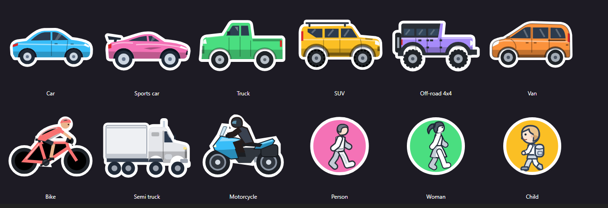

**12 new drawings**, so there are **1,619 drawings** in all.

- **On the move** (People & pets, **On the move (map icons)**): car, sports car (fastback with a rear wing), pickup truck,
  rugged SUV, off-road 4x4, family van, bike, semi truck and motorcycle, plus walking person, woman and child on a
  colored disc. Pick any color for the body (or the disc) and **Facing** right or left. On means moving: wheels turn and
  people walk. Each one has a white outline, so it reads small on a map too.

The **[gallery](https://almulder.github.io/ha-device-art/)** has a **Show: New in 1.3.5** filter.

## What's new in 1.3.4: garage door windows, panels and texture

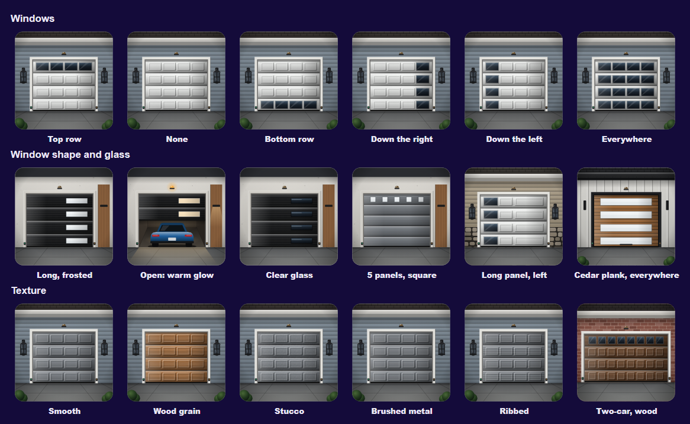

New menus on the garage doors (Outdoor, **Garage doors & gates**). Every menu starts on the look you have now.

- **Windows:** none, top row, bottom row, down the right, down the left or everywhere.
- **Panels:** 4 or 5 (glass doors: glass rows).
- **Window shape:** long narrow or square, and **Glass:** frosted white or clear (Flush modern and Cedar plank).
- **Texture:** smooth, wood grain, stucco, brushed metal or ribbed, over any door color.
- Long windows are taller and frosted white, and windows glow warm when the door is open. In multi-function mode
  they glow when the **Light** part is on.

## What's new in 1.3.3: chicken lamps

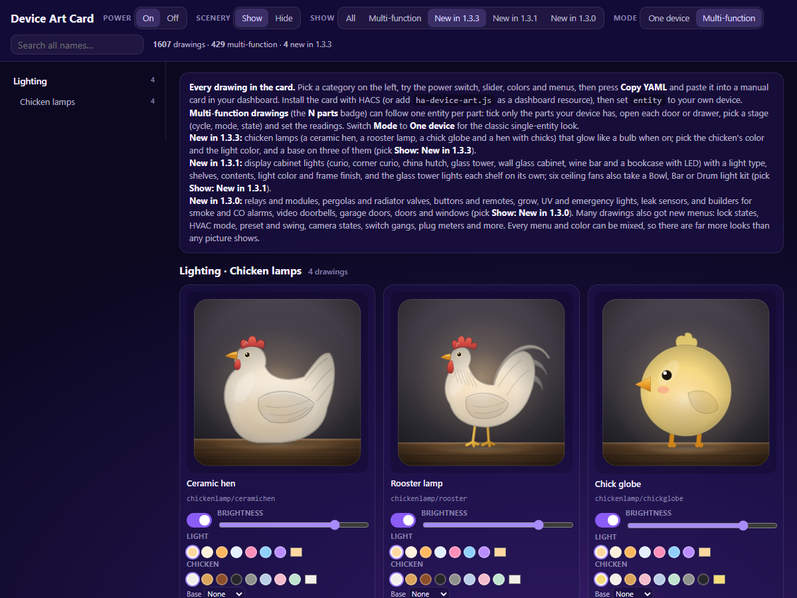

**4 new drawings**, so there are **1,607 drawings** in all.

- **Chicken lamps** (Lighting, **Chicken lamps**): a ceramic sitting hen, a rooster lamp, a round chick globe and a hen
  with her chicks. Each one lights up from inside like a bulb when it's on, and follows the brightness. The first color
  row is the light color; the second row is the **chicken's own color** (white, golden, brown, black, speckled, pastels).
  The ceramic hen, rooster and chick globe also have a **Base** menu: none, wood, egg cup or metal.

The **[gallery](https://almulder.github.io/ha-device-art/)** has a **Show: New in 1.3.3** filter.

## What's new in 1.3.2: fixes

- Baseboard, radiant floor and boiler thermostats get a first Mode, **Automatic**, that looks just like before the Mode menu: it follows on/off and the setpoint (Heat stays a choice).
- The door builder's Deadbolt menu and three smart lock drawings now have plain, descriptive names.
- Double and French doors no longer repeat an internal drawing id when open.
- Cabinet lights, switches, smart locks and deadbolts light up right away (no fade-in); doors still swing open without fading.

## What's new in 1.3.1: display cabinet lights and ceiling fan light kits

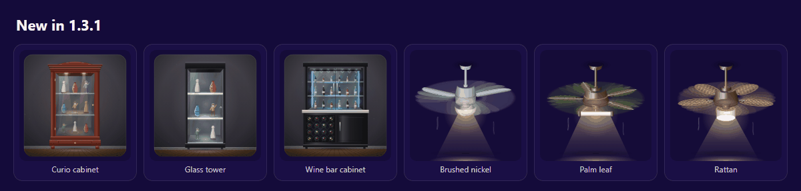

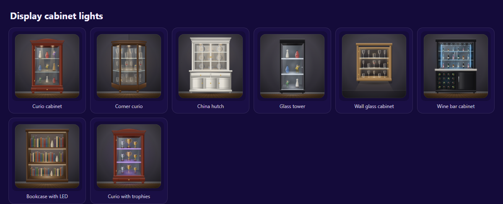

**7 new drawings**, so there are **1,603 drawings** in all.

- **Display cabinet lights** (Lighting, **Cabinet & display**): a curio, a corner curio, a china hutch, a glass tower, a
  wall glass cabinet, a wine bar cabinet and a bookcase with LED, lit from inside. Pick the **Light type**, the number of
  **Shelves** (3, 4 or 5) and the **Contents**; the light takes any color and the second color row is the frame finish.
  The **glass tower** lights each shelf on its own, so each shelf can follow its own entity.
- **Ceiling fan light kits:** six fans without a light of their own (brushed nickel, palm leaf, rattan, windmill,
  minimal white and airplane) can now take a **Bowl**, **Bar** or **Drum** light kit from the **Light kit** menu.
  **Fan only** and **Fan + light** work as before.

The **[gallery](https://almulder.github.io/ha-device-art/)** has a **Show: New in 1.3.1** filter.

## What's new in 1.3.0: new drawings, builders and menus

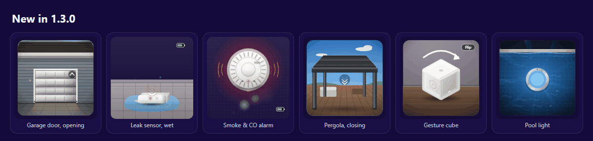

**72 new drawings** (65 more in all, because 7 older video doorbells are now styles of the new doorbell builder), and
**new menus on 129 drawings** you already have. That makes **1,596 drawings** in all.

**New drawings**

- **Relays & modules:** in-wall relays and dimmers (1, 2 or 4 channels, dry contact, pilot wire), flying-lead and mini
  relay boxes, relay boards, DIN-rail modules, a breaker row, a smart load center, LED controllers, plug-in repeaters,
  Wi-Fi extenders and a generic device and sensor. Each channel can follow its own entity.
- **Pergolas & radiator valves:** a louvered pergola (seen from outside and from below), a retractable sail, a patio
  awning and a projector screen that open, close and stop part-way; three radiator valve heads (heat, eco, boost, off) on
  panel, column or towel radiators; outdoor and curtain motion sensors and a window handle.
- **Buttons & remotes:** a dial switch, puck knob, gesture cube, puck and ring buttons, handheld remotes, IR and RF
  blasters, an e-paper scene panel, a touch sensor, a gesture sensor, a key tag and a beacon. Single, double and long
  press each have their own look.
- **Grow, UV, emergency & pool lights:** grow bars, clip-on lamps and shelf strips (full spectrum, red/blue or bloom), a
  blacklight, a UV sanitizer, a twin-head emergency light and a lit EXIT sign (normal, battery, test), pendant and bulb
  groups, an underwater pool light and a spa light.
- **Leak sensors:** 7 leak sensors and a gateway, each in **14 places**: floor, toilet, sink, vanity, dishwasher, washer,
  fridge, water heater pan, HVAC, tub, softener, floor drain, sump pit and crawl space, with probes and a freeze alarm.
- **Smoke & CO alarm builder:** one card for 8 alarm styles: hardwired or battery; smoke, CO, heat or combo; voice;
  normal, test and hush; wall or plug-in.
- **Video doorbell builder:** one card for 17 doorbell styles, each with its own model, power or shape menu: ringing,
  motion, live view and talking, night IR, flat, wedge and corner mounts, and a package light.
- **Garage door builder:** 1 to 4 doors on 6 houses, single or double width, 10 door styles and 4 window styles, and each
  door closed, opening, open, closing, partly open or not closed.
- **Door & window builders:** front, back, patio and interior doors (12 front door styles, sidelights, transom, glass)
  with a lock from the lock sets; windows on siding, brick, stucco and from inside (13 window types, grilles, glass,
  screens, tilt and turn).

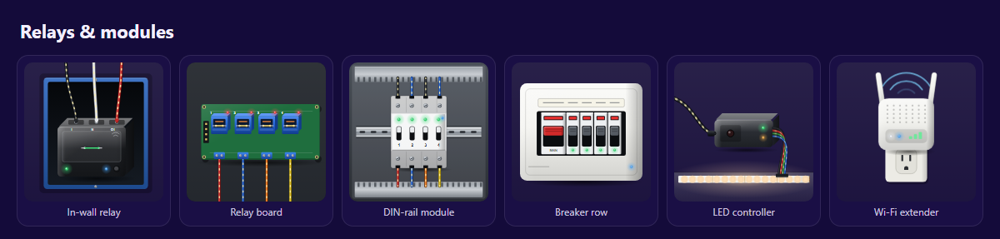
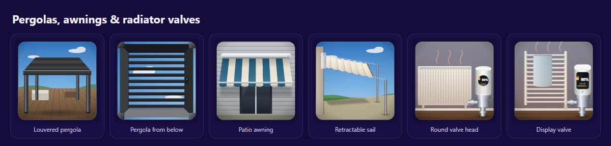
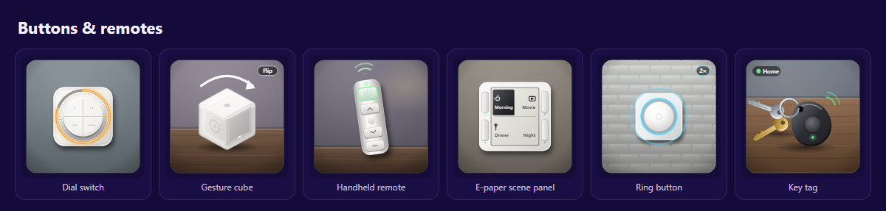
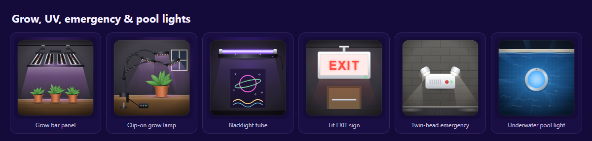
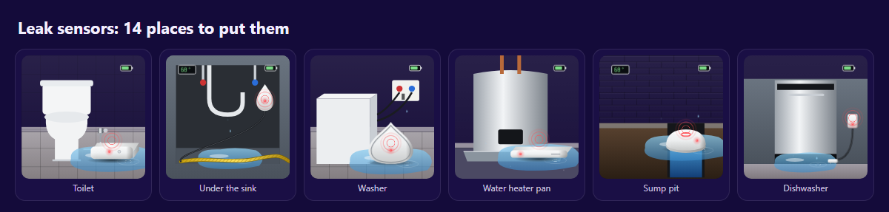
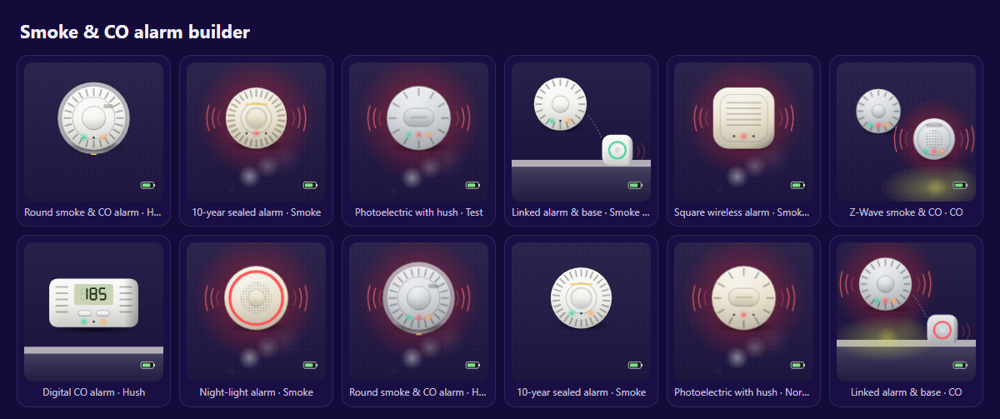
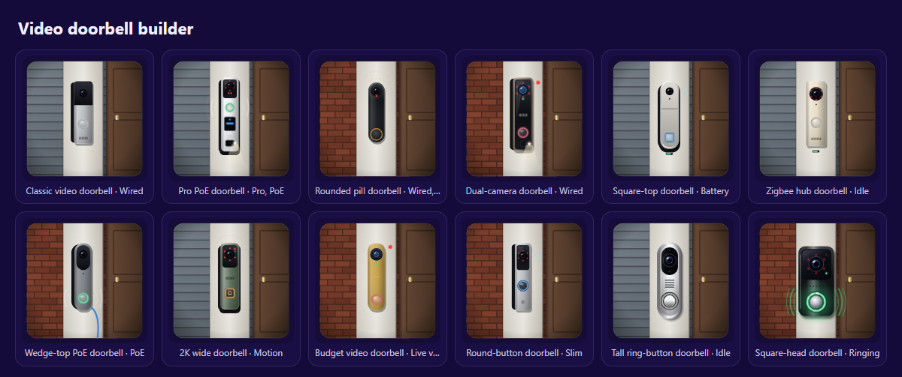
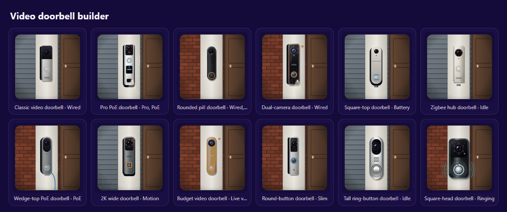
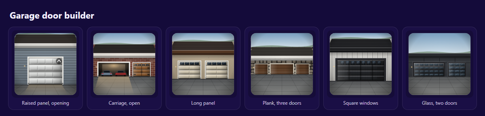
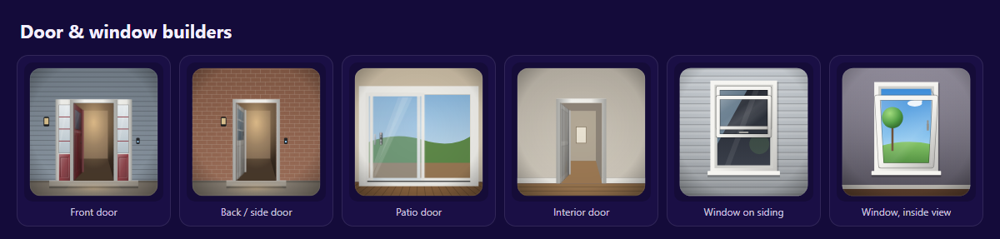

**New menus on drawings you already have**

- **Locks:** a **State** menu with **Locking**, **Unlocking** (bolt part-way, amber light, arrows) and **Jammed** (red
  warning light and badge) on the smart locks and deadbolts. A `lock` entity can drive it:
  `options_from: { state: lock.front_door }`.
- **Heating & cooling:** **Mode** (heat/cool, heat, cool, auto, dry, fan, eco, off), **Preset** (boost, comfort, sleep,
  away, frost) and **Swing** menus on thermostats, air conditioners, wall units and heaters, only where the device has them.
- **Blinds and curtains:** a **Slats** menu (tilted open, half, shut) on venetian and vertical blinds, and **Opens**
  (center, left or right) on curtains and panels; the motorized blinds show opening, closing and partial.
- **Cameras:** a **State** menu (Live, Recording, Motion, Privacy, Offline), **Night IR**, and **Pan** on the pan-tilt heads.
- **Switches:** **Gangs** (1 to 4 on one plate, each gang can follow its own entity), **Main / Aux**, and a **Control**
  menu (paddle, rotary, slide or touch) on some dimmers; the fan controller gets speed steps.
- **Plugs and outlets:** a **watt meter** on smart plugs, and each outlet shows a **plug with its cord** when it is on.
- **Ceiling fans** keep their light kits from 1.2.0: the fan and the light are separate parts, each on its own entity.

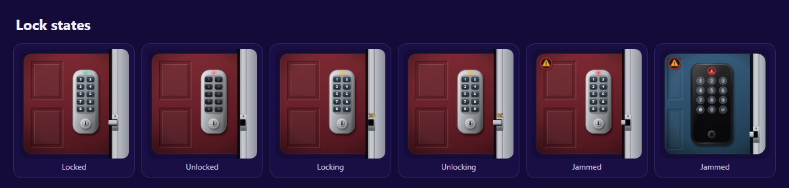
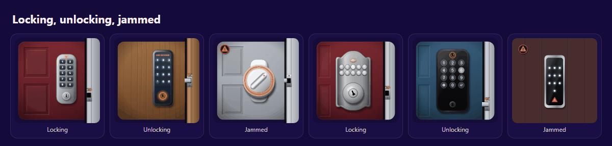
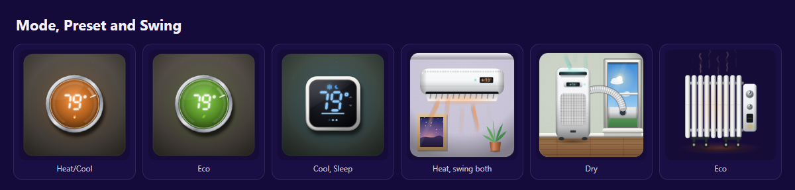
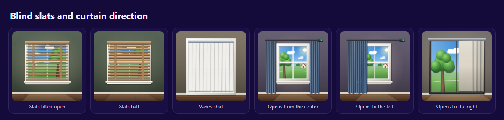
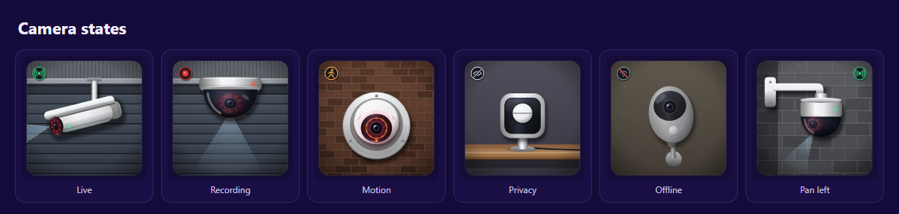
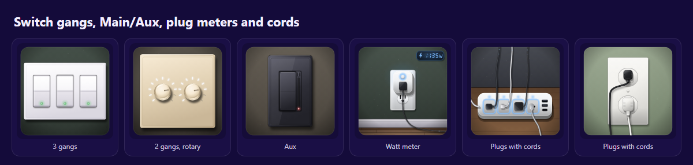

**Your cards keep working.** Every drawing id and part id from 1.2.0 still works. The 7 older video doorbells
(`doorbell/tall`, `doorbell/square`, `doorbell/wedge`, `doorbell/package`, `doorbell/intercom`, `doorbell/gatepost`,
`doorbell/peephole`) left the picker, but a card that uses one shows the same look through the video doorbell builder.

```yaml
# a garage with two doors, each from its own cover
type: custom:device-art-card
art: garagecfg/brick
entity: cover.garage_left
options: { doors: "2" }
options_from:
  s1: cover.garage_left      # closed, opening, open, closing
  s2: cover.garage_right
```

```yaml
# a lock that shows locking, unlocking and jammed
type: custom:device-art-card
art: lock/keypad
entity: lock.front_door
options_from:
  state: lock.front_door
```

The **[gallery](https://almulder.github.io/ha-device-art/)** has a **Show: New in 1.3.0** filter.

## What's new in 1.2.0: multi-function drawings

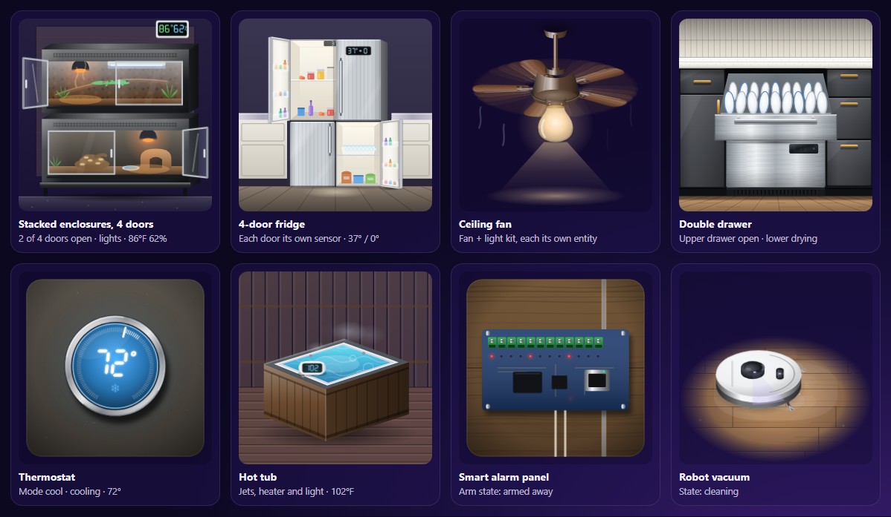

**413 drawings** now have **parts**, and each part can follow its own entity. Turn on `multi_function: true` and tick
only the parts your device really has.

- **Tick only the parts your device has.** A part you leave out stays closed, off or blank, so the drawing shows what
  your device can do and nothing more.
- **Every door and drawer is its own sensor.** A 4-door fridge opens each door on its own; so do dishwasher drawers,
  oven doors, washers, garage doors and enclosures. **One sensor can open several doors:** give the same entity to more than one part.
- **Stages** for appliances, thermostats, vacuums and alarms: wash, rinse, dry and clean on a dishwasher; heat, cool and
  idle on a thermostat; docked, cleaning, returning, charging and error on a robot vacuum; disarmed, home, away and
  alarm on an alarm panel. Each stage has its own animation.
- **Readings on the drawings:** fridge and freezer temperature, water temperature, enclosure temperature and humidity,
  pump speed and more, shown on the device's own display.
- **Lights with level and color:** a light part dims with its brightness and glows in its bulb's color.
- **Ceiling fan light kits:** a new **Light kit** option on the ceiling fans. The fan and the light each follow their own
  entity, and the light takes any color.
- **New drawing: Stacked enclosures, 4 doors** (`habitats/pvcstack`), with a sensor for each door, lights, temperature
  and humidity. That makes **1,529 drawings** in all.
- **Device mode keeps the old look.** Without `multi_function`, a drawing follows one entity just as before. Your
  current cards don't change.
- **The [gallery](https://almulder.github.io/ha-device-art/)** has a **Multi-function** filter, an **N parts** badge on each
  drawing, and a parts panel where you can try every part: tick it, open it, pick its stage or set its reading. The
  **One device / Multi-function** switch shows both looks, and **Copy YAML** writes the `parts:` for you.

| | |
|---|---|
| 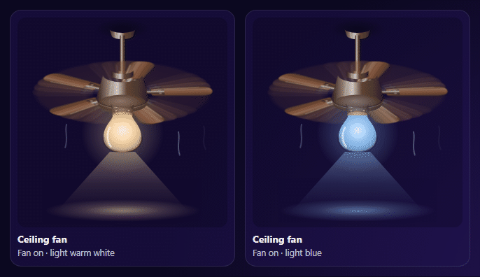 | 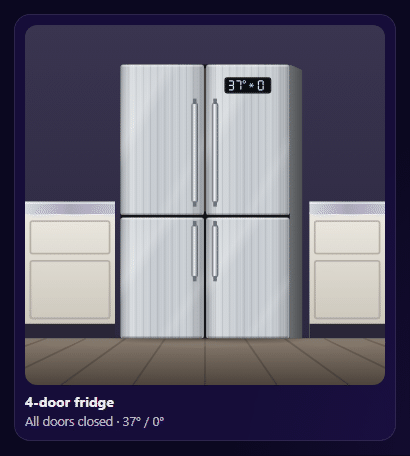 |
| 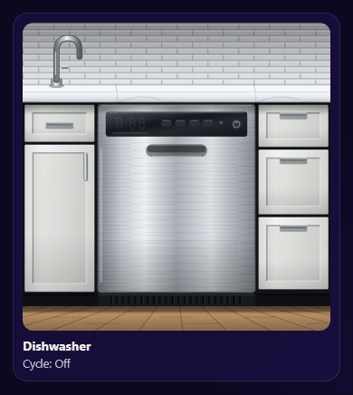 | 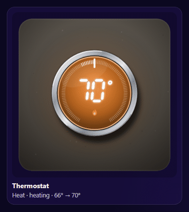 |
| 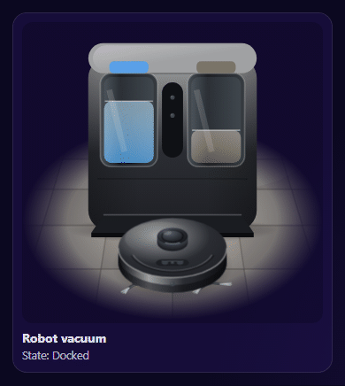 | 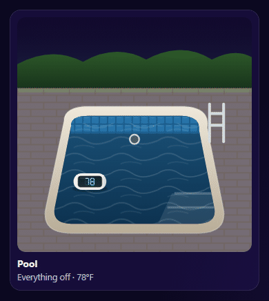 |

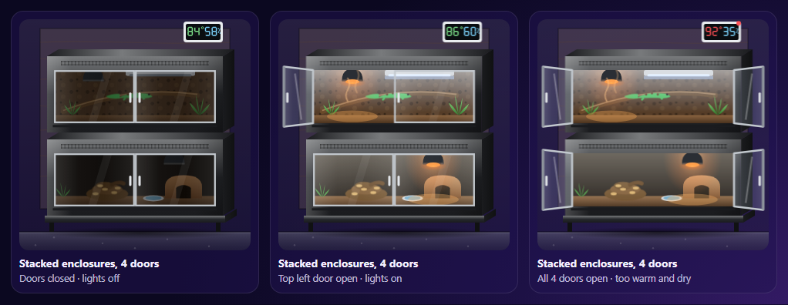

How to set it up: see [Multi-function cards (parts)](#multi-function-cards-parts) below.

## Version history

- **1.3.5:** 12 map icons for people on the move (9 vehicles, 3 walking figures). See above.
- **1.3.4:** garage doors get Windows, Panels, Window shape, Glass and Texture menus. See above.
- **1.3.3:** 4 chicken lamps that glow when on, with a chicken color and a light color. See above.
- **1.3.2:** fixes: thermostat Automatic mode, plain lock names, unique ids on double doors, no fade-in on lights and locks.
- **1.3.1:** 7 display cabinet lights (curio, corner curio, china hutch, glass tower, wall glass cabinet, wine bar,
  bookcase with LED) and Bowl, Bar and Drum light kits on six ceiling fans. See above.
- **1.3.0:** 72 new drawings (relays, pergolas, buttons, grow/UV/emergency/pool lights, leak sensors) and builders for
  smoke & CO alarms, video doorbells, garage doors, doors and windows; new menus on 129 drawings. See above.
- **1.2.0:** multi-function drawings (parts, doors, stages, readings, light level and color), ceiling fan light kits,
  the stacked enclosure, and the gallery's parts panel. See above.
- **1.1.1:** boy hairstyles and outfits for the toddler.
- **1.1.0:** the version line in the browser console, and update notes in this README.
- **Update 2:** people, pets and habitats (57 new drawings, **1,528** in all). Details below.
- **Update 1:** the first release, with 1,471 drawings in 16 categories.

**Update 2: people, pets and habitats**

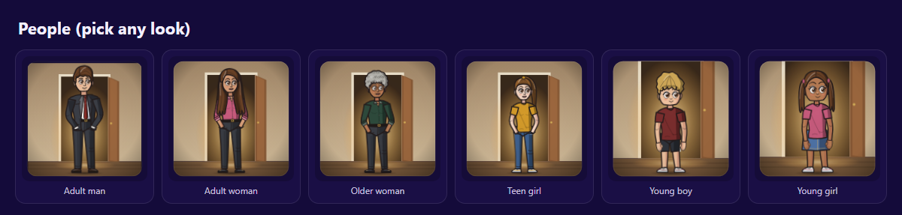

- **People:** adult, older, teen, young boy and girl, toddler and baby. Pick the outfit (casual, business,
  business casual, formal, workout, nightwear, outdoor, hoodie, work uniform and more), hair style and color, facial hair,
  glasses, height, build, skin tone, mobility (cane, walker, wheelchair) and view (face, portrait, half body, full body).
  Each person follows a `person` entity: home, away or a zone.
- **Dogs & cats:** 10 dog breeds and 4 cats with a GPS collar and battery level. Pick the activity (resting, sleeping,
  walking, playing, eating), the zone, and the coat and collar colors.
- **Reptile & pet habitats:** 19 enclosures (gecko, chameleon, python, bearded dragon, bioactive, frog, tortoise, turtle,
  axolotl, tarantula, birds, hamsters, rabbits, incubator and brooder). Each shows temperature and humidity that turn
  amber or red outside the animal's safe range. Heat lamp, UVB, mister and more each switch on their own.
- **Chicken coops:** 14 coops and pieces of gear, showing the water level and coop temperature, with an auto door,
  heat lamp, light and waterer heater.

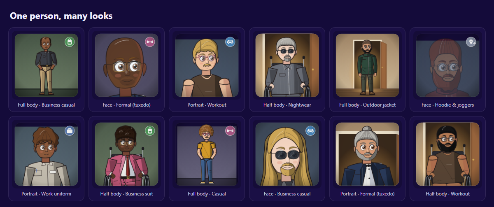

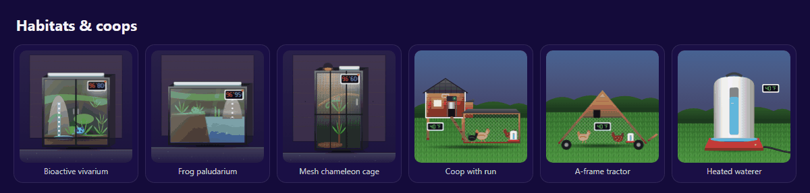

**How many looks?** The menus alone make **over 59 million** combinations (most of them from the people). Counting the
preset color dots too, that's **over 4 billion**, and every drawing with a color picker takes any color on top of that. The
plant and tree builders add 1,620 more plant-and-pot combinations.


---

**[Browse the full gallery →](https://almulder.github.io/ha-device-art/)** It has every drawing, live, with all its options.
Pick a look, then press **Copy YAML** to get a card ready to paste.

---

## What you can change

Almost everything on a drawing can be set. The pictures below show only a few of the possibilities.

| Option | What it does |
|---|---|
| **Background on or off** (`scenery: false`) | Hides the wall, floor, counter or yard so the device stands alone and blends into any card or theme. |
| **On / off** | Follows your entity: lights glow, fans spin, appliances run, doors open, locks lock. |
| **Level** | Follows brightness, fan speed, cover position, volume or any number: dims lamps, speeds fans, fills tanks, opens blinds. |
| **Color** (`color`) | The main color: a light's color (it follows a color bulb automatically), or a body, finish, fabric or flower color. |
| **Second color** (`color2`) | A second part: lamp shades and globes, switch LEDs, fireplace surrounds, cooktop glass, doorbell rings. |
| **Parts** (`parts`) | Parts of one device that switch on their own, each from its own entity: microwave, light and fan on an over-the-range microwave; oven and each burner on a range; washer and dryer in a pair. |
| **Multi-function** (`multi_function: true`) | Each door, drawer, light, reading and stage follows its own entity, and the parts you leave out stay closed, off or blank. See [Multi-function cards](#multi-function-cards-parts). |
| **Menus** (`options`) | Pick a look or a state: fridge style, washer cycle (wash, rinse, spin), range fuel and burners, outlet region (US, EU, UK, AU and more), fireplace surround and many more. Menus can follow an entity too (`options_from`). |
| **Animation** (`animate: false`) | Still pictures only. Animation also turns off by itself when your device asks for reduced motion. |
| **Name and state** (`show_name`, `show_state`, `name`) | Show or hide the label under the drawing. |
| **Tap** (`tap_action`) | `toggle`, `more-info` or `none`. |

### Background on or off

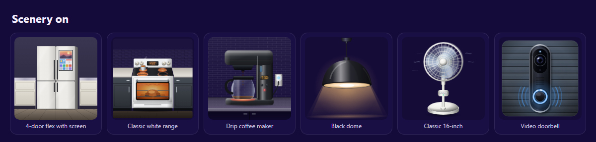
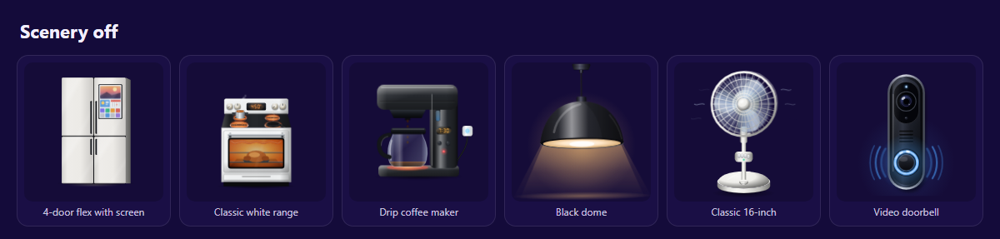

---

## Install

**HACS (recommended)**
1. HACS → ⋮ → **Custom repositories** → add `https://github.com/almulder/ha-device-art`, type **Dashboard**.
2. Install **Device Art Card**, then reload your browser.

**Getting updates:** HACS shows "Update available" for each new version. After updating, reload the page
(Ctrl+F5, or in the phone app: Settings → Companion App → Debugging → Reset frontend cache). To check your version,
open the browser console: it shows `DEVICE-ART-CARD v1.3.5`.

**Manual**
1. Copy `dist/ha-device-art.js` to `config/www/`.
2. Settings → Dashboards → ⋮ → **Resources** → add `/local/ha-device-art.js` as a **JavaScript module**.

---

## Use it

Add a **Manual** card and paste. The easiest way: open the [gallery](https://almulder.github.io/ha-device-art/), set the look,
press **Copy YAML**, then change `entity`.

```yaml
# a lamp that glows in your bulb's color and dims with it
type: custom:device-art-card
art: pendant/globe
entity: light.dining_pendant
```

```yaml
# a fan that spins with its speed, no background
type: custom:device-art-card
art: ceilingfan/classic
entity: fan.bedroom
scenery: false
```

```yaml
# a washer and dryer pair: each machine from its own entity, the cycle from a sensor
type: custom:device-art-card
art: laundrycfg/cfgscreen
options: { mach: both, layout: stack, ped: none }
parts:
  washer: switch.washer_running
  dryer: switch.dryer_running
options_from:
  wcyc:
    entity: sensor.washer_job_state
    map: { wash: wash, rinse: rinse, spin: spin, finished: done }
```

```yaml
# an over-the-range microwave: microwave, light and fan each on their own
type: custom:device-art-card
art: rangecfg/cfg-otrglass
parts:
  mw: switch.microwave
  light: light.hood_light
  fan: fan.hood_fan
```

Menu ids and values are shown in the gallery's **Copy YAML** output for each drawing.

### Multi-function cards (parts)

A drawing with parts can follow **one entity per part**. Add `multi_function: true` and list the parts your device has
under `parts`, as `part id: entity`. The gallery shows each drawing's part ids (press **Copy YAML** in
**Multi-function** mode), and every part has a type:

| Part type | What it shows | Give it | Read from the entity |
|---|---|---|---|
| **switch** | A light, fan, pump, heater or screen that is on or off | a `light`, `switch`, `fan`, `input_boolean`... | On or off. A light's brightness and color follow it too; a fan's speed follows its percentage. |
| **contact** | A door or drawer that opens | a `binary_sensor` or `cover` | Open (`on`, `open`, `opening`) or closed. |
| **value** | A reading on the drawing (temperature, humidity, speed) | a `sensor`, `number` or `input_number`, or any entity with `attribute` | Its number (or the attribute's). |
| **stage** | A cycle, mode or state, each with its own animation | a `sensor`, `select`, `climate`, `vacuum`..., or any entity with `attribute` | Its state (or the attribute), matched to a stage id or name, or through `map`. |

Any part can read an **attribute** instead of the state: `{ entity, attribute }`, for example
`temp: { entity: climate.hallway, attribute: current_temperature }` or
`state: { entity: climate.hallway, attribute: hvac_action }`. A switch or contact part that reads an attribute is on
when the value is an "on" word (`on`, `open`, `heating`...) or a number above 0; add `on_states: [...]` to choose.

Rules:
- A part **you leave out** stays closed, off or blank, so list only what your device really has.
- **One entity can drive several parts**: give the same `binary_sensor` to two doors and they open together.
- `entity` (the main one) still sets the name, the state text under the drawing and the tap action.
- `part_names` gives parts your own names, for example `part_names: { d1: Gecko, d2: Snake }`.
- A **stage** reads the entity's state (or its `attribute`). If your states have other names, use `{ entity, map }` to
  turn them into the drawing's stage ids (the gallery's **Copy YAML** lists each part's stage ids).
- Without `multi_function`, the drawing works as before: one entity, the switch parts follow it, and if `entity` is a
  door sensor (`binary_sensor` or `cover`) every door opens with it.

```yaml
# a 4-door fridge: each door its own sensor, the inside light, and both temperatures
type: custom:device-art-card
art: fridgecfg/steel
entity: sensor.fridge_temperature
options: { style: flex4 }
multi_function: true
parts:
  tl: binary_sensor.fridge_door_top_left
  tr: binary_sensor.fridge_door_top_right
  bl: binary_sensor.freezer_doors      # one sensor for both bottom doors:
  br: binary_sensor.freezer_doors      # they open together
  light: binary_sensor.fridge_door_top_left
  temp: sensor.fridge_temperature
  ftemp: sensor.freezer_temperature
```

```yaml
# a ceiling fan with a light kit: the fan spins with its speed, the light dims and takes its bulb's color
type: custom:device-art-card
art: ceilingfan/classic
entity: fan.bedroom_fan
multi_function: true        # turns the light kit on (or set options: { kit: light })
parts:
  fan: fan.bedroom_fan
  light: light.bedroom_fan_light
```

```yaml
# a dishwasher: the door, and the cycle stage from the appliance's status sensor
type: custom:device-art-card
art: dishwasher/front
entity: sensor.dishwasher_status
multi_function: true
parts:
  door: binary_sensor.dishwasher_door
  cycle:
    entity: sensor.dishwasher_status
    map: { "off": idle, ready: idle, washing: wash, rinsing: rinse, drying: dry, finished: done }
```

```yaml
# a thermostat: mode, operating state, fan mode, room temperature and setpoint
type: custom:device-art-card
art: thermostat/learning
entity: climate.hallway
multi_function: true
parts:
  mode:
    entity: climate.hallway                  # its state is the mode: off, heat, cool, auto...
    map: { heat_cool: auto }
  state:
    entity: climate.hallway
    attribute: hvac_action                   # idle, heating, cooling, fan
  fan:
    entity: climate.hallway
    attribute: fan_mode                      # auto, on, circulate
  temp:
    entity: climate.hallway
    attribute: current_temperature
  sp:
    entity: climate.hallway
    attribute: temperature                   # the setpoint
```

```yaml
# a robot vacuum: its state picks the stage (docked, cleaning, returning, charging, paused, error)
type: custom:device-art-card
art: vacuum/allinone
entity: vacuum.downstairs
multi_function: true
parts:
  state:
    entity: vacuum.downstairs
    map: { idle: docked }
```

```yaml
# a pool: pump, heater and light each on their own, and the water temperature
type: custom:device-art-card
art: pool/inground
entity: switch.pool_pump
multi_function: true
parts:
  pump: switch.pool_pump
  heater: switch.pool_heater
  light: light.pool_light
  temp: sensor.pool_water_temperature
```

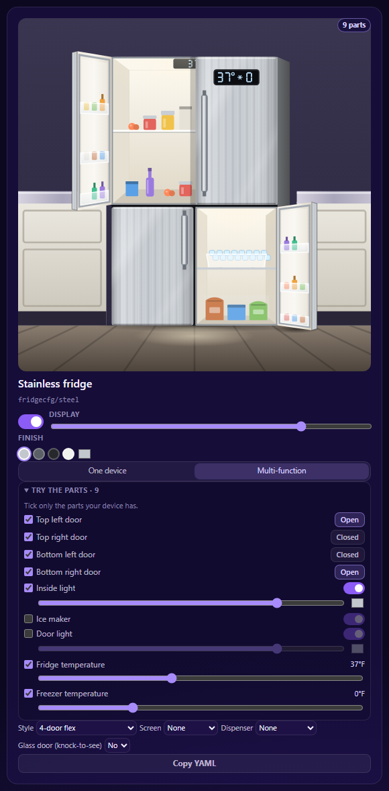

### All settings

| Key | Example | Notes |
|---|---|---|
| `art` | `pendant/globe` | Required. The drawing (`set/drawing`); the gallery shows each one. |
| `entity` | `light.kitchen` | Drives on/off, level and (for lights) color. |
| `name`, `show_name`, `show_state` | `Kitchen`, `true`, `true` | The label under the drawing. |
| `color`, `color2` | `"#ffd27a"` | Override the colors. |
| `options` | `{ style: flex4 }` | Fixed menu choices. |
| `options_from` | `{ cycle: sensor.x }` or `{ cycle: { entity, map } }` | Menu choices that follow an entity's state. |
| `parts` | `{ fan: fan.hood }` | Part id → entity, or `{ entity, map }` for a stage part. Without `multi_function`, parts without an entity follow the main one. |
| `multi_function` | `true` | Each part follows its own entity; parts left out stay closed, off or blank. |
| `part_names` | `{ d1: Gecko }` | Your own names for the parts. |
| `level`, `level_attribute`, `min`, `max` | `0.6`, `percentage`, `0`, `100` | Fixed level, or where to read it from. |
| `on_states`, `on_above` | `[running, heating]`, `5` | What counts as "on" (default: on, open, playing, heating, cleaning, running and similar). |
| `scenery` | `false` | Background off. |
| `animate` | `false` | Still picture. |
| `tap_action` | `toggle` | `toggle`, `more-info` or `none`. |
| `plant`, `pot`, `pot_color` | plant builder | Pick any plant and pot (see Plants below). |

---

## Builder cards: one card, many looks

Some cards are builders: pick the style, layout and extras from menus, and the drawing changes to match. The grids below show
**a few of the combinations, not all of them.** Every color, finish and menu can be mixed, and most drawings take any color.

**Fridge builder.** Side by side, French door, 4-door flex, 2 doors + 2 drawers, top or bottom freezer, column pair; door screen; ice and water dispenser; glass door.
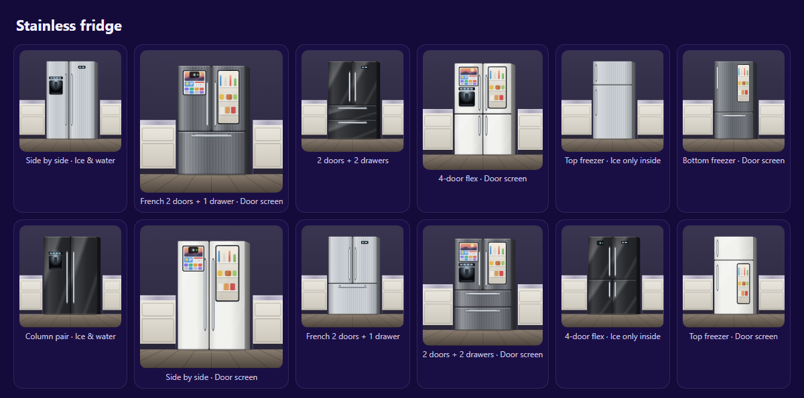
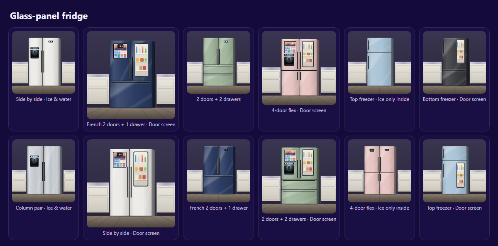

**Washer & dryer builder.** Washer, dryer or both; side by side or stacked; pedestal; wash, rinse, spin and dry cycles.
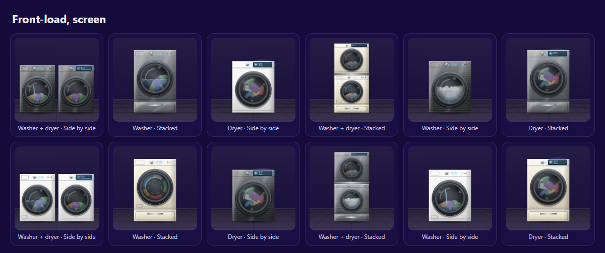
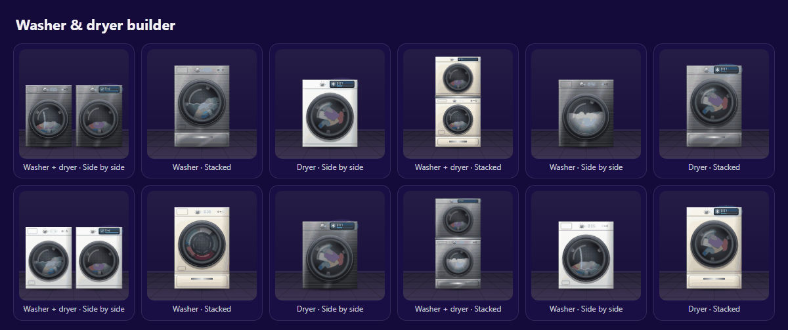

**Range builder.** Gas, coil, glass or induction; freestanding or slide-in; 4 to 6 burners; single or double oven; each burner and oven on its own.
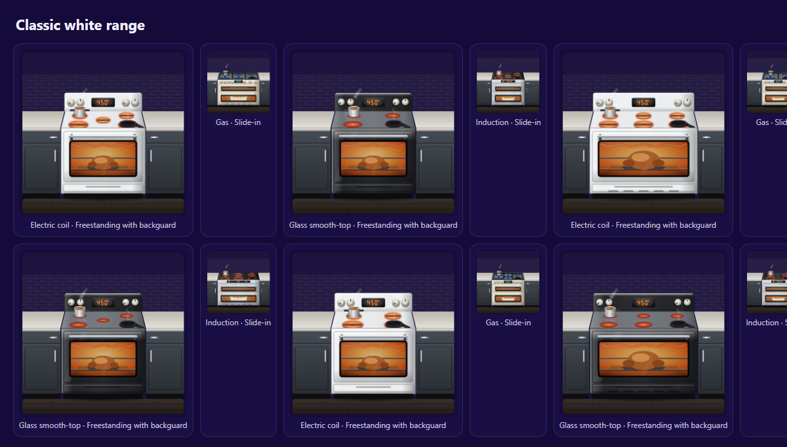

**Fireplaces.** Surround (brick, stacked stone, tile, painted, wood, marble) in any color, mantel, and flame color.
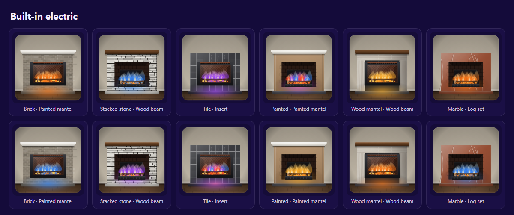

**Garage door builder.** 1 to 4 doors on 6 houses; single or double; 10 door styles and 4 window styles; each door closed, opening, open, closing or partly open.


**Door & window builders.** Front, back, patio and interior doors with a lock from the lock sets; 13 window types with grilles, glass and screens.


**Video doorbell builder.** 17 styles, each with its own model, power or shape; ringing, motion, live view and talking; night IR; mounts.


**Smoke & CO alarm builder.** 8 styles; hardwired or battery; smoke, CO, heat or combo; normal, test and hush.


**Plant & tree builder.** Any plant in any pot, in any pot and flower color; plants droop when they need water.
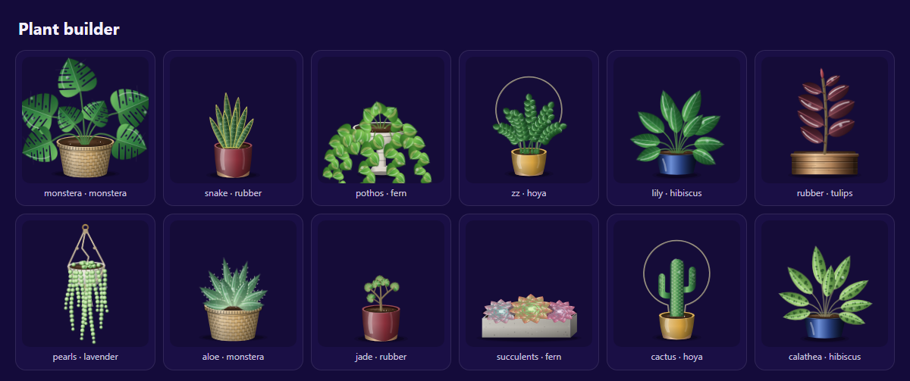

---

## Every category

A sample from each category, 1,619 drawings in all. The [gallery](https://almulder.github.io/ha-device-art/) has all of them.

| | |
|---|---|
| 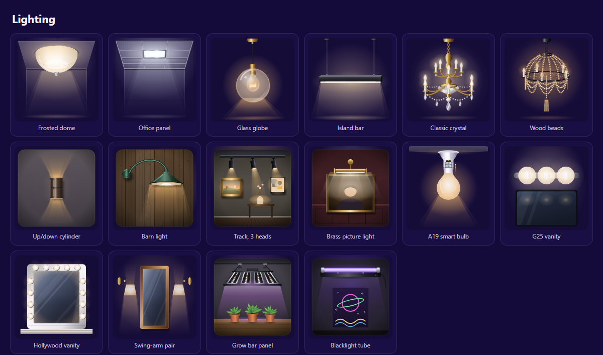 | 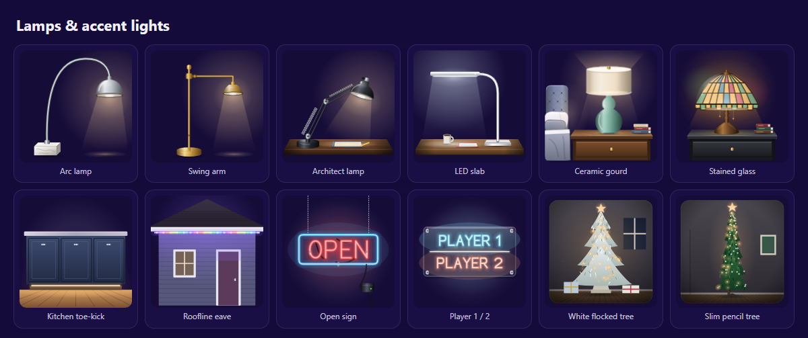 |
| 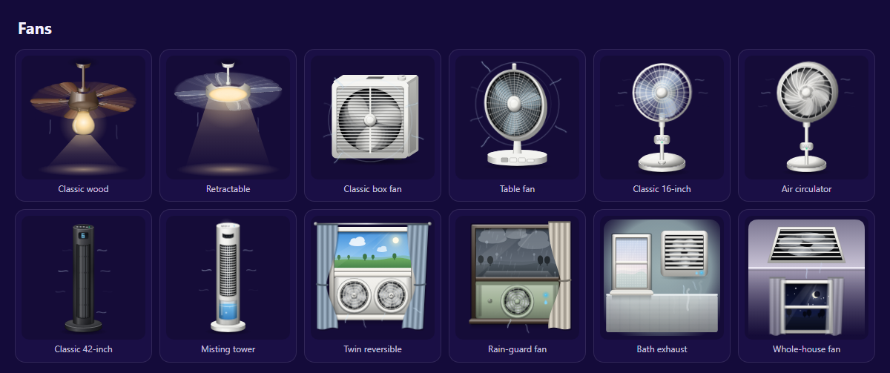 | 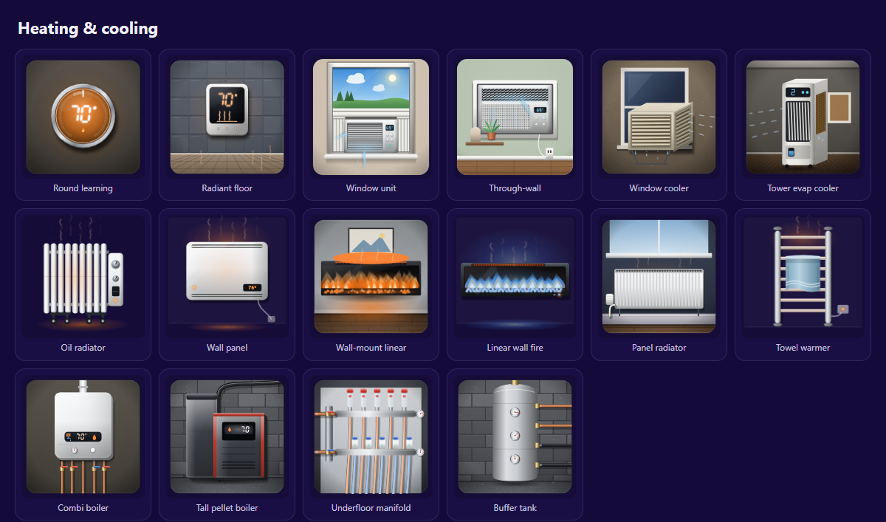 |
|  |  |
|  |  |
|  |  |
|  |  |
|  |  |
|  |  |
|  | |

---

## License

Free to use: code and artwork are under the [MIT License](LICENSE). Use them, change them and share them, including in your own
projects. Just keep the license notice.

## Disclaimer

All drawings in this project are original artwork, made from scratch. They are generic illustrations of common household devices.
Any resemblance to a real brand, product, model, trade dress or trademark is coincidental, a result of drawing everyday objects
realistically. This project is **not affiliated with, endorsed by, sponsored by or connected to** any manufacturer, brand or
company, including Home Assistant / Nabu Casa. All product and company names belong to their owners. None are used here.

The software is provided "as is", without warranty of any kind.
